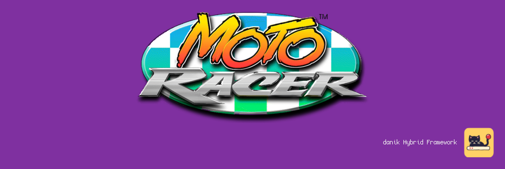
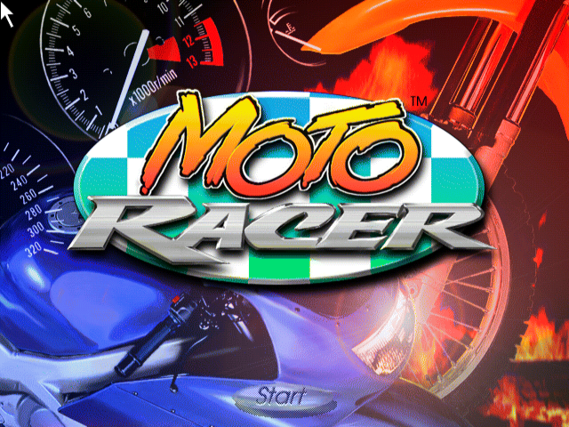
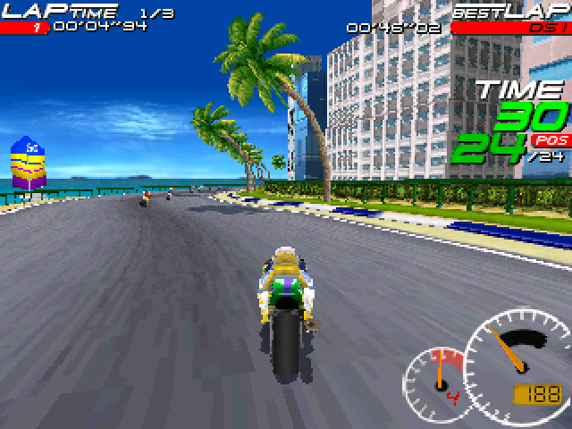

# OpenMotoRacer for MiSTer

Moto Racer on [MiSTer FPGA](https://github.com/MiSTer-devel/Main_MiSTer/wiki) as a hybrid port.

The game is [OpenMotoRacer](https://github.com/ItsDanik/OpenMotoRacer), a new program written by hand to do what Delphine Software's 1997 program does, software renderer included, reading its tables from your own copy of the game. It runs on the MiSTer's ARM CPU. The OpenMotoRacer FPGA core provides native 15kHz video (CRT, VGA and HDMI) at 320x240 and 640x240 in a race and 640x480 in the menus, 44.1kHz audio and keyboard, mouse and gamepad input. The two halves talk through shared DDR3 memory.

> **Beta.** Expect rough edges and please report problems in the issues.
>
> **Disclaimer:** AI is being extensively used to speed up development, but the project is well-maintained and supported.

  
  

## Requirements

- **danik_hybrid_ports**, the launcher: run it **once** from the MiSTer's `Scripts` menu ([The launcher](#the-launcher)). Without it the core says "Game not running".
- **Game data**, which is not included: the full game, either GOG's *Moto Racer* or the original 1997 CD.
- **Recommended:** a gamepad with two analog sticks and analog triggers, like an Xbox or PlayStation controller. A gamepad without them works but is not recommended. The game can also be played with a keyboard and mouse.

## Installation

With `update_all` (Downloader 2.4 or newer, which update_all keeps up to date):

1. Copy [`downloader_danik_hybrid_ports.ini`](https://raw.githubusercontent.com/ItsDanik/Hybrid_MiSTer/main/launcher/downloader_danik_hybrid_ports.ini) to the root of your SD card (`/media/fat`).
2. Run `update_all`. That installs the launcher, **danik_hybrid_ports**, in `Scripts`.
3. Run **danik_hybrid_ports** from the `Scripts` menu, tick the games you want and press *X: Apply*. They are installed, and update_all keeps them up to date.
4. Copy **everything** in your game's folder to `/media/fat/games/dnk/OpenMotoRacer/`, all the files as they are:

   | Your copy | Goes in | Known by |
   |---|---|---|
   | GOG's, as installed | `Moto Racer/` | `game.EXE`, `data/`, `02.wav` to `13.wav` |
   | The 1997 CD's files and its image | `Moto Racer/`, or `Moto Racer CD/` next to GOG's | `DISK1/`, `DATA/`, its `.cue` and `.bin` (the image holds the music) |

5. Load the game from the `Other` menu, e.g. **dnk-Moto Racer**, or from the `Hybrid Ports` folder if you moved the games there in the launcher.

> [!NOTE]
> The game data can go on a USB drive instead, into the same folder there (`/media/usb0/games/dnk/OpenMotoRacer/`): the game looks for it there first, and then keeps its settings and saved games there as well. Everything else stays on the SD card.

> [!IMPORTANT]
> **HDMI or VGA:** if you play on HDMI or on a VGA monitor rather than a 15kHz CRT, open the OSD and set *HDMI Only* to **Yes**. The game's menus are drawn at 640x480, which is interlaced for a CRT and shows combing on any other screen without it.

The game's log is in `/media/fat/logs/dnk/OpenMotoRacer/openmotoracer.log`. Settings, records, championships and time attack ghosts are in `games/dnk/OpenMotoRacer/saves/`. There is one menu entry for either copy: with both copies there GOG's is played, and *Game Behaviour* on the game's *Options* page picks which program's ways the game follows.

## The launcher

**danik_hybrid_ports** is what turns a menu entry into a running game. Once you've run it from the `Scripts` menu, it starts with the MiSTer, watches which core is loaded, and starts the game whenever a hybrid port's menu entry is loaded. It serves all our hybrid ports at once and updates itself through `update_all`.

Run it from the `Scripts` menu again whenever you want to change something. Its screen has:

- **Launcher**: on or off. Off, the ports' games no longer start (the core says "Game not running"), until you turn it on again.
- **Menu entries**: where the games appear in the MiSTer menu:
  - **Other, as dnk-\<Title\>**: each game in the `Other` menu, e.g. **dnk-Doom** (the default).
  - **Other/Hybrid Ports**: all of them in a *Hybrid Ports* folder in `Other`, without the `dnk-` in front.
  - **Main menu/Hybrid Ports**: a *Hybrid Ports* folder of its own in the main menu, next to `Arcade`, `Console` and `Other`.

  Moving them keeps each game's settings and button mappings. Favourites, recent lists and Zaparoo tags that point at the old place have to be made again.
- **The ports and their games**, a tickbox each. Tick what you want, untick what you don't.

*X: Apply* installs what is ticked and removes what is not, through Downloader, and moves the menu entries if you chose another place. When a port is removed, your game data, saved games and settings stay, and ticking it again brings it back as it was.

## OSD options

| Option | |
|---|---|
| Aspect ratio, Scale, Scandoubler Fx, Stereo Mix | as in other cores |
| FPS Counter | shows the pictures per second in the top left corner |
| HDMI Only | **Yes** if no CRT is connected: resolutions of 640x400 and more are then progressive instead of interlaced, and so is the core's own screen before the game, which moves at 60 pictures a second for a CRT and shows fine lines on HDMI without it. The analog output is switched off while one is shown, so that a 15kHz screen can never get such a signal. Nothing changes at lower resolutions. Not needed with `forced_scandoubler=1` (VGA monitor); not there with `direct_video=1` |
| CRT Options | **Horizontal Size**: the picture's width **Horizontal Pos**: moves it left or right **Vertical Pos**: moves it up or down **HUD (Top)**: moves the lap, time and position texts and the turn signs down **HUD (Bottom)**: moves the dials and the bottom texts up, and Options and Exit in the main menu **Flicker Filter**: Strong (default), Light or Off: softens fine lines that blink while the picture is interlaced  For a 15kHz screen: fits the picture to it and keeps the HUD out of the overscan. HDMI is not affected but by the Flicker Filter; not there with `forced_scandoubler=1` |
| Resolution | **320x240** (default) **640x240**  The race's picture; the menus are always 640x480. Both hold a steady 60 pictures a second |
| Limit to 30 FPS | **Off** (default) or **On**: a steady 30 pictures a second |
| Smooth Motion | **On** (default): pictures between the game's steps, as smooth as the screen **Off**: the game's steps as they are |
| Analog | **On** (default): the stick and the triggers work by degrees **Off**: all or nothing |
| Rumble | **On** (default) or **Off**: the gamepad's rumble |
| Cheats | **All Tracks**: every track unlocked **Reverse Tracks**: the tracks backwards **Pocket Bikes**: the small bikes **No Time Limit**: the race's clock never runs out **Slow Rivals**: the other riders ride slowly, from the next race  The first three are the game's own; typing them in the game still works |
| Reset | starts the game again from its beginning, as the USER button does |
| Save Diagnostic Report | the last line: see [If something is wrong](#if-something-is-wrong) |

## Controls

- **Keyboard and mouse:**

| Key | Action |
|---|---|
| Up, Down | accelerate, brake |
| Left, Right | steer |
| A, Z | higher gear, lower gear |
| Space | turbo, stunts |
| Tab | look back |
| Esc, Pause | the race's menu, pause |
| F1 | the game's help, with every other key |
| F2, F3 | the other resolution |
| F5, F6 | camera distance, on-board view |
| F7, F8, F9 | dashboard, turn signs, map |
| F10 | Smooth Motion |
| F11, F12 | the sound and display columns |
| Arrows, Return, Esc, mouse | the menus |

*Config* next to *Controller* on the game's *Options* page changes the race's keys.

- **Gamepad** (default mapping):

| Button | Action |
|---|---|
| Left stick | steers, by degrees; moves in the menus |
| D-pad | steers; moves in the menus |
| A (Xbox B / PlayStation Circle) | accelerate; back in the menus |
| B (Xbox A / PlayStation Cross) | brake; OK in the menus |
| X (Xbox Y / PlayStation Triangle) | turbo, stunts |
| Y (Xbox X / PlayStation Square) | camera: chase or on board |
| L (LB / L1) | lower gear |
| R (RB / R1) | higher gear |
| Select | look back |
| Start | pause |
| R2, L2 | accelerate, brake, by degrees |
| L3, R3 | dashboard, map |

Change the buttons in the OSD under *Define OpenMotoRacer buttons*. The game's menus confirm and go back with your MiSTer menu's *Menu OK* / *Menu Back* buttons, also when they are game actions too. While the OSD is open, the game gets no input.

> [!WARNING]
> A button left without a name in *Define OpenMotoRacer buttons* does not reach the game at all, except L2/R2, L3/R3 and *Menu OK* / *Menu Back*. Name every button there, or leave the definition as it is. To go back to the default buttons, delete `config/inputs/OpenMotoRacer_input_*_v3.map` on the SD card.

The game's own menu can change what each gamepad button does: *Options*, *Config* next to *Controller*. Change the actions there rather than in the OSD; a button the OSD leaves without a name never reaches the game, so its menu cannot bind it. Y stops changing the camera once an action there uses it.

Typing a name without a keyboard: on the name page move to a letter and press A. For a record, up/down changes the letter, right adds one, left takes one away, Menu OK confirms.

## If something is wrong

If the game stutters, the sound breaks up or something else is wrong, open the OSD while it happens and pick **Save Diagnostic Report**, the last line of the menu. The game keeps running; MiSTer's info box says the report is saved in `games/dnk/diagnostics/` on the SD card. Send that file (`OpenMotoRacer_<date>_<time>.zip`) with a few words on what went wrong.

The report has the setup (versions, the video and audio lines of `MiSTer.ini`, the OSD settings), how the last 60 seconds went, the game's log and a screenshot. Nothing else: no network settings, addresses, saved games or lists of your files.

## Building

How the port works, how to build it and notes for development: [NOTES.md](NOTES.md).

## Support

If you enjoy this project, you can support my work on [Patreon](https://www.patreon.com/itsdanik).

## Credits

- **OpenMotoRacer** by ItsDanik, from *Moto Racer* by Delphine Software (1997).
- **[SDL](https://libsdl.org)** by Sam Lantinga and contributors.
- **[MiSTer](https://github.com/MiSTer-devel)** by Sorgelig and the MiSTer-devel contributors: the framework and Template_MiSTer.
- **[MiSTer Frontier](https://github.com/MiSTerOrganize/MiSTer_Frontier)** by MiSTer Organize: thank you for the inspiration. Hybrid cores on the MiSTer, and the way their game is launched (a daemon that watches the loaded core and runs a script from its games folder), were inspired by MiSTer Frontier.

This project and its maintainers are in no way associated with or endorsed by Delphine Software, Electronic Arts, Microids or anyone else holding rights to *Moto Racer*. It does not include any game data.

## License

The top-level scripts, tools and documentation are licensed under the [GPL-3.0](LICENSE). The components keep their own licenses: the part of the shared framework the game is linked with (`hybrid/hps/`) is GPL-2.0-or-later, the rest of `hybrid/` GPL-3.0 except where its files say otherwise, the game (`openmotoracer/`) GPL-3.0, SDL and the SDL drivers in `hybrid/sdl2` are zlib, the FPGA core and the MiSTer framework are GPL-2.0 (`core/LICENSE`, with the core's own sources GPL-2.0-or-later).
